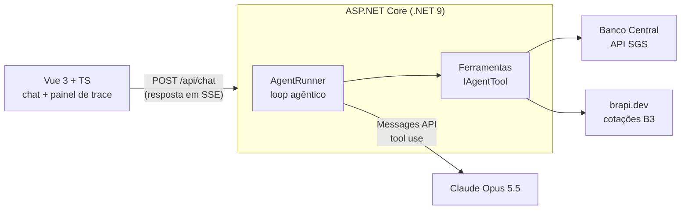

<div align="center">

# 💹 FinCopilot

**Agente de IA para educação financeira com dados reais e contas que não erram**


</div>

Agente de IA para educação financeira. Ele responde perguntas sobre investimentos usando **dados reais** da B3 e do Banco Central e faz as contas com **ferramentas determinísticas**. A interface mostra cada passo do agente: o raciocínio, as ferramentas que ele chamou, as entradas e saídas de cada uma, o tempo e o custo.

> ⚠️ Projeto de portfólio. Conteúdo educativo, não é recomendação de investimento.

<!-- Adicione aqui um GIF da interface mostrando o trace em ação -->

## ✨ O que ele faz

- 🏦 *"Qual a Selic hoje e quanto rende R$ 10 mil em um ano num CDB a 100% do CDI?"*: o agente consulta a Selic e o CDI no Banco Central e simula o rendimento.
- 📊 *"Se eu investir R$ 500 por mês a 11% ao ano por 20 anos, quanto terei? Considere 4% de inflação."*: ele roda a simulação de juros compostos e devolve o valor nominal e o valor real.
- 📈 *"Compare o desempenho de hoje de PETR4, VALE3 e ITUB4."*: ele busca as três cotações em paralelo e compara.

## 🏗️ Arquitetura



**O loop do agente** ([AgentRunner.cs](backend/src/FinCopilot.Api/Agent/AgentRunner.cs)):

1. Envia o histórico, o system prompt e as definições das ferramentas ao modelo.
2. Se o modelo pedir ferramentas (`stop_reason = tool_use`), executa todas **em paralelo** e devolve os resultados numa única mensagem.
3. Repete até o modelo responder sem pedir ferramentas, ou até o limite de iterações. Na última iteração permitida, as ferramentas ficam desabilitadas (`tool_choice: none`) para forçar uma resposta final.
4. Cada passo é emitido como evento SSE (`thinking`, `tool_call`, `tool_result`, `text`, `usage`), que o frontend desenha como uma linha do tempo.

### 🧰 Ferramentas

| Ferramenta | Fonte | O que faz |
|---|---|---|
| 📈 `get_stock_quote` | brapi.dev | Cotação de ações, FIIs e ETFs da B3 (até 10 tickers por chamada) |
| 🏦 `get_economic_indicator` | Banco Central (SGS) | Selic, CDI, IPCA mensal e IPCA acumulado em 12 meses |
| 🧮 `simulate_compound_interest` | Cálculo local | Juros compostos com aportes mensais e correção pela inflação |

## 🧠 Decisões técnicas

🔢 **Contas em ferramentas, não no LLM.** Modelos de linguagem erram aritmética com confiança. O modelo decide *quais* parâmetros usar; o código C#, coberto por testes, garante o resultado. O system prompt proíbe calcular projeções de cabeça.

🔁 **Loop manual em vez de framework.** O loop tem cerca de 100 linhas e fica explícito: dá para ver exatamente quando o modelo é chamado, como os blocos de resposta voltam ao histórico e onde cada evento do trace nasce. Para um projeto que quer demonstrar entendimento do mecanismo, isso vale mais do que esconder tudo atrás de uma abstração.

🛟 **Falhas de ferramenta voltam para o modelo.** Erros de validação, timeouts e indisponibilidade de APIs viram `tool_result` com `is_error: true`, e o agente explica o problema ao usuário em vez de inventar números. Se um ticker falha, os outros continuam valendo.

📜 **Histórico append-only.** Os blocos de raciocínio (thinking) vêm assinados e precisam voltar intactos. O histórico só cresce; quando uma execução falha, apenas os turnos daquela execução são descartados, e o prefixo fica intacto.

⚡ **Prompt caching.** O system prompt é estático (sem data nem dados do usuário) e as definições das ferramentas têm ordem fixa, então o prefixo é reaproveitado entre turnos. O painel de trace mostra os tokens lidos do cache e o custo de cada resposta.

🔀 **Fallback em recusas.** As requisições usam `fallbacks: "default"`: se um classificador de segurança recusar, a API tenta automaticamente o modelo recomendado. Recusas que mesmo assim chegam são tratadas antes de ler o conteúdo.

🛡️ **Saída do modelo é conteúdo não confiável.** O Markdown da resposta é sanitizado com DOMPurify antes de ser renderizado.

## 🚀 Como rodar

**Pré-requisitos:** .NET 9 SDK, Node 20+ e uma [chave da API da Anthropic](https://platform.claude.com/).

```bash
# 1. Backend (porta 5080)
cd backend/src/FinCopilot.Api
dotnet user-secrets set "Anthropic:ApiKey" "sk-ant-..."
# opcional: libera todos os tickers da B3 (sem token, só PETR4, VALE3, ITUB4 e MGLU3)
dotnet user-secrets set "Brapi:Token" "seu-token"
dotnet run

# 2. Frontend (porta 5173, com proxy de /api para o backend)
cd frontend
npm install
npm run dev
```

Abra http://localhost:5173.

Em `appsettings.json` você pode trocar o modelo, o nível de esforço (`low`, `medium`, `high`, `xhigh` ou `max`) e o limite de iterações.

### 🧪 Testes

```bash
cd backend && dotnet test     # ferramentas: cálculo, parsing das APIs, validação de entrada
cd frontend && npm test       # parser de SSE e reducer de eventos do trace
```

## 📁 Estrutura

```
backend/
  src/FinCopilot.Api/
    Agent/        loop agêntico, eventos SSE, system prompt, preços, conversas
    Tools/        ferramentas do agente (IAgentTool)
    Program.cs    DI e endpoint /api/chat
  tests/FinCopilot.Tests/
frontend/
  src/
    composables/  useAgentChat: estado da conversa e leitura do stream
    lib/          parser de SSE, reducer de eventos, markdown, formatação
    components/   chat, mensagem, painel de trace
```

## 🗺️ Roadmap

- [x] **Fase 1:** agente com tool use, trace visível, custo por resposta
- [ ] **Fase 2:** análise de carteira (cadastro de ativos, diversificação, gráficos)
- [ ] **Fase 3:** ferramentas expostas como servidor MCP em C#, mais RAG com conteúdo educativo e citações
- [ ] **Fase 4:** evals automatizados, guardrails testados e painel de observabilidade
- [ ] Streaming token a token da resposta final
- [ ] Persistência das conversas (hoje ficam em memória)
